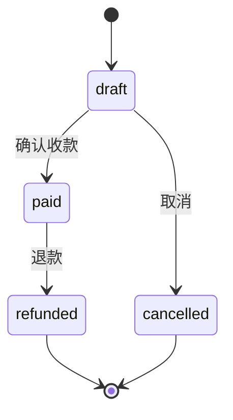

# 01 业务范围与验收标准

## 1. 业务背景（一句话）

一家做企业服务的公司需要内部 CRM：销售维护客户档案，并为客户创建、跟进订单。系统只有两个角色：管理员和只读观察员。

选它的理由：两个实体天然 1:N，能在一个真实约束下同时考出列表、表单、关联选择、状态流转、权限与冲突处理，而不需要任何图表。

## 2. 角色与权限矩阵

| 能力                      | admin | viewer |
| ------------------------- | ----- | ------ |
| 登录 / 查看列表与详情     | ✅    | ✅     |
| 新建 / 编辑客户、订单     | ✅    | ❌     |
| 删除客户、订单            | ✅    | ❌     |
| 订单状态流转              | ✅    | ❌     |
| 接口层拦截（mock 也校验） | 放行  | 403    |

要点：**权限不能只在按钮上 `disabled`**。mock handler 同样按角色返回 403，证明"前端隐藏"不是唯一防线。viewer 登录后所有写操作按钮不渲染（而非置灰），并在 README 说明理由。

## 3. 实体与字段

### 3.1 Customer

| 字段                  | 类型       | 约束                                            | 说明                       |
| --------------------- | ---------- | ----------------------------------------------- | -------------------------- |
| id                    | string     | `cus_` + nanoid                                 | 服务端生成                 |
| name                  | string     | trim 后 2–40 字，必填                           | 列表主列、可搜索           |
| industry              | enum       | tech / retail / finance / manufacturing / other | 筛选项                     |
| level                 | enum       | key / normal / potential                        | 重点 / 普通 / 潜在，筛选项 |
| status                | enum       | active / inactive                               | 停用即"归档"，不删除数据   |
| ownerId               | string     | 必须是存在的成员                                | 负责人，异步下拉           |
| phone                 | string?    | 宽松校验：`^1[3-9]\d{9}$` 或空                  | 详情展示                   |
| email                 | string?    | 合法邮箱或空                                    | 详情展示                   |
| note                  | string?    | ≤ 200 字                                        | 多行文本                   |
| createdAt / updatedAt | ISO string | 服务端生成                                      | 排序默认 `-createdAt`      |

### 3.2 Order

| 字段                  | 类型        | 约束                                   | 说明                           |
| --------------------- | ----------- | -------------------------------------- | ------------------------------ |
| id                    | string      | `ord_` + nanoid                        | 服务端生成                     |
| orderNo               | string      | `ORD-YYYYMMDD-####`，唯一              | 服务端生成，不可编辑           |
| customerId            | string      | 必须存在且客户为 active                | 异步搜索下拉                   |
| amountCents           | integer     | 1 – 100,000,000（即 ¥0.01–¥1,000,000） | **金额以分存储**，展示层格式化 |
| status                | enum        | draft / paid / refunded / cancelled    | 只能通过流转接口修改           |
| paidAt                | ISO string? | 进入 paid 时写入                       | 只读                           |
| note                  | string?     | ≤ 200 字                               |                                |
| createdAt / updatedAt | ISO string  |                                        |                                |

金额用整数分：避免浮点误差，也让 `sum` 类需求以后不用改存储。展示统一走 `<MoneyText cents={...} />`。

## 4. 订单状态机

规则（全部在 mock 与未来的服务端实现，前端只做按钮可用性提示）：

1. 只允许上图三条边，其余流转返回 409 `INVALID_TRANSITION`。
2. `paid` 订单不可删除（返回 409 `ORDER_PAID`），只能退款。
3. `refunded` / `cancelled` 为终态，只读。
4. 编辑订单时不允许直接改 `status` 字段（zod 的 update schema 不含 status）。

这四条让"订单"不只是换个皮肤的 CRUD，也给了测试清晰的断言点。

## 5. 关联与删除策略

| 场景                 | 行为                                             | 错误码                    |
| -------------------- | ------------------------------------------------ | ------------------------- |
| 删除无订单的客户     | 成功，204                                        | —                         |
| 删除有订单的客户     | 拒绝，返回关联订单数，前端提示"先归档或转移订单" | 409 `CUSTOMER_HAS_ORDERS` |
| 给 inactive 客户建单 | 拒绝，表单 customerId 字段报错                   | 422 `CUSTOMER_INACTIVE`   |
| 并发编辑（P1）       | 基于 `updatedAt` 的乐观锁，冲突返回 409          | 409 `STALE_WRITE`         |

删除客户不做级联：级联删订单在业务上不可接受，这个判断本身要在 ADR 里写清楚。

## 6. 功能清单

### P0（必须，约 11h）

| 编号 | 功能            | 验收标准（简写）                                                                                 |
| ---- | --------------- | ------------------------------------------------------------------------------------------------ |
| F1   | 登录 + 角色切换 | 两个演示账号可登录；viewer 看不到任何写操作入口；刷新后保持登录                                  |
| F2   | 客户列表        | 关键词搜索（防抖 300ms）、level/status 筛选、排序、分页；所有条件进 URL；刷新/分享链接后状态还原 |
| F3   | 客户新建/编辑   | 抽屉表单；前端校验 + 服务端 422 字段错误回填；成功后列表刷新且 toast                             |
| F4   | 客户删除        | 二次确认；有订单时展示 409 文案与关联数量；成功后分页回退逻辑正确（删掉当页最后一条回到上一页）  |
| F5   | 订单列表        | 按状态筛选、按客户筛选、按金额/时间排序、分页；列内展示客户名（不额外请求 N 次）                 |
| F6   | 订单新建/编辑   | 客户异步搜索下拉；金额输入以元为单位、提交转分；状态不可在表单里改                               |
| F7   | 订单状态流转    | 只显示当前状态允许的动作；成功后行内更新 + toast；409 时回滚并提示                               |
| F8   | 空/载入/错误态  | 三个共享态组件，列表、抽屉、下拉均覆盖；错误态可重试                                             |
| F9   | 响应式基线      | ≥1280 正常；≥768 表格横向滚动不破版；≤480 侧边栏收起                                             |

### P1（有时间就做，约 3h）

| 编号 | 功能              | 价值                                                                                |
| ---- | ----------------- | ----------------------------------------------------------------------------------- |
| F10  | 批量删除客户      | 展示选择态与部分失败汇总（207 语义）                                                |
| F11  | 换后端演练 server | 同契约的 Hono/Express 本地服务，`VITE_API_MODE=http` 后全流程可用，证明 mock 可替换 |
| F12  | OpenAPI 导出      | `pnpm contract:openapi` 生成 `contract/openapi.json`，作为交付给后端的接口文档      |
| F13  | 乐观锁冲突        | 两个标签页同时编辑，后提交者看到冲突提示并可刷新                                    |

### P2（不做，只写进"后续"）

仪表盘、导出 Excel、附件、审计日志、多租户、i18n。

## 7. 页面清单

| 路由             | 页面     | 说明                                        |
| ---------------- | -------- | ------------------------------------------- |
| `/login`         | 登录     | 两个一键登录按钮，不接真鉴权                |
| `/customers`     | 客户列表 | 主工作台，含筛选/表格/抽屉                  |
| `/customers/:id` | 客户详情 | 基本信息 + 该客户的订单列表（复用订单表格） |
| `/orders`        | 订单列表 |                                             |
| `/orders/:id`    | 订单详情 | 只读 + 状态操作                             |
| `*`              | 404      |                                             |

不做单独的 dashboard 路由，登录后直接进 `/customers`——少一个页面，多一份 harness 时间。

## 8. 术语表

| 术语       | 含义                                                                           |
| ---------- | ------------------------------------------------------------------------------ |
| harness    | 让 AI/人持续产出正确代码的上下文、约束、反馈与流程的总和，区别于一次性的脚手架 |
| 模式层     | 可复用但不做代码生成的组件层（DataTable、ResourceForm）                        |
| 契约       | 请求/响应的结构与校验规则的唯一来源（本项目为 Zod schema）                     |
| 门禁       | 提交前必须通过的自动化检查（lint/typecheck/test/contract/build）               |
| 换后端演练 | 把 mock 关掉、指向真实 HTTP 服务，验证业务代码零改动                           |
