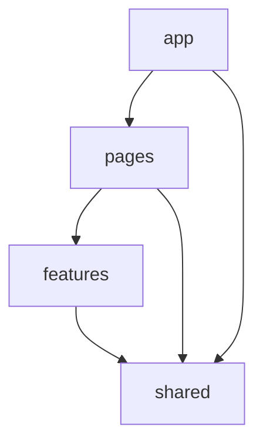

# 02 架构与复用边界（AntD 版）

> 版本基线：React 19 · Ant Design 6.x · Vite 7+ · TanStack Query v5 · Zod 4 · MSW 2 · Vitest · Playwright。
> AntD 6 与 5 在 Modal/Drawer 销毁、主题 CSS 变量等细节上有差异，M3 开工前先花 30 分钟做一次 API 核对（见第 5.4 节），不顺则退回 5.27.x 并在 ADR 记录。

## 1. 分层

```
app（路由、Provider、布局、守卫）
  └─ pages（路由级页面，只做编排）
       └─ features（customers / orders / auth：schema、api、列定义、表单配置）
            └─ shared（ui 封装、api 客户端、lib、config）
```

依赖只允许**从上往下**。`shared` 不认识任何 feature；feature 之间互不 import；`app` 可被 pages 引用，但 feature 不能反向依赖 `app`。



## 2. 目录

```
src/
  app/
    router.tsx            # createBrowserRouter，路由级 lazy
    providers.tsx         # ConfigProvider(zhCN) + App + QueryClient + ErrorBoundary
    guard.tsx             # RequireAuth / RequireRole（读 route handle.roles）
    layout/               # Layout / Sider / Header / Breadcrumb
  pages/
    login/index.tsx
    customers/{list,detail}.tsx
    orders/{list,detail}.tsx
    not-found.tsx
  features/
    auth/{api.ts,schema.ts,session.ts}
    customers/
      api.ts              # 只调 shared/api/client
      schema.ts           # 实体 / create / update / filters
      columns.tsx         # antd ColumnsType<Customer>
      form.tsx            # FieldConfig[] + 默认值 + 元↔分映射
      hooks.ts            # useCustomerList / useCustomerMutations
    orders/…
  shared/
    ui/
      data-table/         # 包一层 antd Table：三态 + 工具栏 + URL 分页
      resource-form/      # 包一层 antd Form：FieldConfig 驱动 + zod 校验
      filter-bar/         # 筛选容器 + 已选条件 + 重置
      page-header/ confirm-dialog/ empty-state/ error-state/ status-badge/ money-text/
    api/
      client.ts           # 唯一 HTTP 出口，错误归一化
      errors.ts           # ApiError + 错误码 → 文案
      query-keys.ts
      mock/               # MSW：db / seed / latency / failure / handlers
    lib/
      use-url-state.ts    # 筛选、分页、排序 ↔ URLSearchParams
      use-debounced-value.ts
      format.ts           # 金额、日期、手机号脱敏
    config/env.ts         # zod 校验 import.meta.env
  test/{setup.ts,utils.tsx,msw/server.ts}
  mocks/browser.ts        # 仅 mock 模式动态 import
```

不建 `components/` 大杂烩、不建 `utils/` 垃圾桶。文件放哪里由"它认识谁"决定。

## 3. 依赖规则用 ESLint 固化

```js
// eslint.config.js 片段
import boundaries from 'eslint-plugin-boundaries'

settings: {
  'boundaries/elements': [
    { type: 'app', pattern: 'src/app/*' },
    { type: 'pages', pattern: 'src/pages/*' },
    { type: 'features', pattern: 'src/features/*', capture: ['feature'] },
    { type: 'shared', pattern: 'src/shared/*' },
  ],
},
rules: {
  'boundaries/element-types': ['error', {
    default: 'disallow',
    rules: [
      { from: 'app', allow: ['pages', 'features', 'shared'] },
      { from: 'pages', allow: ['features', 'shared'] },
      { from: 'features', allow: ['shared'] },          // 跨 feature 一律禁止
      { from: 'shared', allow: ['shared'] },
    ],
  }],
  'no-restricted-globals': ['error',
    { name: 'fetch', message: '网络请求统一走 shared/api/client' },
  ],
}
```

`shared/api/client.ts` 与 `test/**` 用 overrides 放行 `fetch`。

## 4. 状态归属

| 状态 | 归属 | 理由 |
|---|---|---|
| 服务端数据 | TanStack Query | 缓存、失效、重试、竞态 |
| 筛选 / 分页 / 排序 | **URL** | 可分享、可后退、刷新不丢 |
| 表单草稿 | antd Form 实例（非受控） | 少重渲染，`setFields` 可直接回填服务端错误 |
| 抽屉开关、选中行 | 组件本地 state / antd Table 的 rowSelection | 不需要跨页 |
| 登录态 | Query + localStorage（mock token） | 刷新保持 |
| 全局 store | **没有** | 没有跨页客户端共享状态 |

## 5. AntD 集成约束

### 5.1 必须

- 入口包 `ConfigProvider locale={zhCN} theme={{ token }}`，`dayjs.locale('zh-cn')`。
- 用 `<App>` 包裹业务树，**提示类 API 一律 `App.useApp()`** 取 `message / modal / notification`。直接 `import { message } from 'antd'` 会丢失主题与 locale 上下文（静态方法警告）。
- 引入 `antd/dist/reset.css`，不额外引 normalize。
- 日期统一 dayjs；金额统一整数分，`InputNumber` 的 `formatter/parser` 只负责显示。
- 表格 `rowKey` 必填且类型上强制，避免 React key 警告与选择态错乱。

### 5.2 不做

- **不用 `@ant-design/pro-components`（ProTable / ProForm）**。它会把"表格 + 表单 + CRUD"这件本题要考的事直接外包掉，复用叙事变成"我用了 ProTable"，且包体和定制成本都更高。
- **不用 unplugin 自动导入**。这是对你现有 Vue 模板的有意偏离：AI 生成代码时隐式符号无法静态追踪，review 时看不出依赖来源，ESLint 的 import 边界规则也会被绕过。显式 import 让 diff 可读、边界可查。ADR 记录。
- 不改 antd 组件源码、不用覆盖去改主题；定制走 `ConfigProvider` token。
- 不引入第二套样式体系（Tailwind / 另一套 CSS-in-JS）。

### 5.3 封装原则

antd 已经解决了"组件长什么样"，我们只补三件事：**三态、URL 同步、字段配置驱动**。封装层不重新实现分页、排序、选择、校验样式——那是在和 antd 打架。

### 5.4 版本核对清单（M3 开工前 30 分钟）

AntD 6 相对 5 的差异点，逐项确认后再落代码：

- Modal/Drawer 关闭销毁的属性名（`destroyOnClose` / `destroyOnHidden`）；
- `Form.validateFields` 的 reject 结构与 `setFields` 的入参形状；
- `Table` 的 `pagination` / `onChange` / `rowSelection` 类型是否有调整；
- 主题是否默认 CSS 变量模式（`cssVar`），对 token 覆盖的影响；
- `@ant-design/icons` 6 的按需导入路径与 tree-shaking。

核对结论写进 `docs/adr/0002-antd-version.md`；若 6.x 有阻塞性问题，退回 5.27.x，其余设计不变。

## 6. 共享组件的 API 草案

### DataTable

```tsx
import type { TableProps, TablePaginationConfig } from 'antd'
import type { ColumnsType } from 'antd/es/table'

export type SortState = { field: string; order: 'asc' | 'desc' } | null

export type DataTableProps<T> = {
  columns: ColumnsType<T>
  rows: T[]
  rowKey: keyof T & string | ((row: T) => string)
  /** 联合类型，天然避免"载入中闪现空态" */
  status: 'loading' | 'error' | 'empty' | 'ready'
  error?: ApiError
  onRetry?: () => void
  empty?: { title: string; description?: string; action?: ReactNode }
  pagination: TablePaginationConfig & { total: number }
  sort?: SortState
  onQueryChange?: (next: { page: number; pageSize: number; sort: SortState }) => void
  toolbar?: ReactNode
  rowSelection?: TableProps<T>['rowSelection']
  scrollX?: number
}
```

实现要点：

- `status === 'error'` 时整块替换为 `ErrorState`，不渲染表格（避免"空表 + 报错"双重噪声）。
- `status === 'empty'` 用 `locale.emptyText` 渲染带行动的 `EmptyState`。
- `loading` 只透传给 antd 的 `loading`，不自己画骨架。
- `onChange(pagination, filters, sorter)` 归一化成 `{ page, pageSize, sort }` 再交给 URL hook；列上的 `sortOrder` 由 `applySortOrder(columns, sort)` 注入，保证刷新后箭头正确。
- 分页固定 `showSizeChanger`、`showTotal`（`共 N 条`），`current` 从 URL 来，组件不持有分页状态。

### ResourceForm

```tsx
export type FieldConfig<T> =
  | { kind: 'text'; name: keyof T; label: string; placeholder?: string }
  | { kind: 'textarea'; name: keyof T; label: string; rows?: number }
  | { kind: 'money'; name: keyof T; label: string }        // 元输入 → 分提交
  | { kind: 'select'; name: keyof T; label: string; options: Option[] }
  | { kind: 'asyncSelect'; name: keyof T; label: string
      load: (keyword: string) => Promise<Option[]>; cacheKey: string; minChars?: number }
  | { kind: 'date'; name: keyof T; label: string }

export type ResourceFormProps<T extends FieldValues> = {
  schema: ZodType<T>
  fields: FieldConfig<T>[]
  initialValues?: Partial<T>
  onSubmit: (values: T) => Promise<void>
  layout?: 'one' | 'two'
  submitText?: string
  onCancel?: () => void
}
```

### useResourceList

```ts
const { rows, status, error, filters, setFilter, reset, pagination, sort, refetch } =
  useResourceList({
    key: 'customers',
    list: customersApi.list,
    filterSchema: customerFiltersSchema,
    defaultFilters: { page: 1, pageSize: 10, sort: '-createdAt' },
  })
```

`status` 由 hook 内部统一推导（`isPending` / `isError` / `rows.length === 0` / `ready`），页面不再各写一套三元表达式。

## 7. 表单校验：zod 是唯一来源

antd Form 自带 `rules`，但我们**不写 rules**——两份规则必然漂移。做法：

```tsx
async function handleFinish(values: unknown) {
  const parsed = schema.safeParse(values)
  if (!parsed.success) {
    form.setFields(toFormErrors(parsed.error))   // ZodError → antd 字段错误
    return
  }
  try {
    await onSubmit(parsed.data)
  } catch (e) {
    if (isApiError(e) && e.fields) form.setFields(toFormErrors(e.fields))  // 422 回填
    else setFormLevelError(e)                                            // 409/500 顶部 Alert
  }
}
```

- 失焦校验：`onBlur` 时对该字段单独 `schema.pick(...)` 校验，补足"提交才知道错"的体验。
- 必填星号：`Form.Item required` 只做视觉，真校验仍在 zod。
- **元测试**：遍历 `FieldConfig[]`，断言每个必填字段在 schema 里确实会拒绝空值，防止"字段加了、校验忘了"。
- 元↔分：`money` 字段在 `onSubmit` 前转 `Math.round(yuan * 100)`，回填时 `/100`；转换函数单独测试。

好处：一份校验同时服务实时校验、提交校验、服务端 422、契约测试，答辩时能直接讲清"为什么不用 antd rules"。

## 8. 复用怎么长出来（顺序很重要）

要区分两类抽象：

**展示型组件（形状稳定，可以先生成）**：表格、分页、三态、抽屉、确认框。M3 建好 `DataTable` / `ResourceForm`，用客户模块校准 props；订单模块接入时只允许**扩展**（如 `rowSelection`、`scrollX`），不改既有语义。

**编排型逻辑（差异未知，必须两遍之后）**：`useResourceList` 第一遍不知道哪些是客户特有的。所以：

1. 模块 A 先直写 `useCustomerList`，允许重复与不完美。
2. 模块 B 开工时再抽 `useResourceList`。
3. 抽完回头改 A，跑 A 的测试确认无回归。**"改 A"这一步才是复用的证据**（git log 可见）。
4. 第三个使用点（客户详情里嵌订单列表）验证：只传 columns 和 rows，不改 `shared/`。

判断标准一句话：**新增同类模块 ≤ 1 小时，且不动 `shared/`**。

## 9. 错误处理链路

```
fetch 失败 / 非 2xx
  → client.ts 归一化为 ApiError { status, code, message, fields? }
  → Query 抛错
  → 列表：ErrorState（可重试）
  → 表单：422 → form.setFields；409/500 → 表单顶部 Alert
  → 401：清 token 跳登录（带 redirect）
  → 403：message.error「当前角色无权限」，不跳转
  → 409：对话框文案 + 建议动作（"该客户有 3 个订单"）
  → 未知异常：路由级 ErrorBoundary 兜底
```

`client.ts` 用 zod 解析错误体，解析失败回落 `INTERNAL`，保证 UI 永远拿到稳定结构——这也是 mock 与真后端同构的前提。

## 10. 与 `antd-vue3-admin` 的对应关系

参考项目是 Vue 3 + antd-vue 4 + Pinia，已有 `AGENTS.md + 按需规则 + Skills + 工具强制` 的分层规范。React 版沿用同一套骨架，只换实现：

| Vue 模板 | React 版 | 说明 |
|---|---|---|
| `hooks/useCurd.ts`（fetch/add/edit/del + 防抖 + 删除末页回退） | `useResourceList` + `useResourceMutations` | **保留**末页回退、250ms 防抖这两个细节 |
| `hooks/useTable.ts` | `DataTable` + URL 状态 | 分页状态从组件搬到 URL |
| `hooks/useFormModel.ts` + `FormModel.vue` | `ResourceForm` + `Drawer` | 改为 FieldConfig 驱动 |
| `utils/request.ts`（axios 拦截器 + 401 刷新队列） | `shared/api/client.ts` | 401 用简单跳转，不做刷新队列（无真后端） |
| `stores/permission.ts` + `asyncRouterMap` | 路由 `handle.roles` + `RequireRole` | 菜单与路由同源，避免两处权限表 |
| `unplugin-auto-import` | 显式 import | 理由见 5.2 |
| multi-tab / keep-alive | 不做 | 与本题无关，成本高于收益 |
| `.codebuddy/rules/*.mdc` + `skills/*/SKILL.md` | `docs/rules.md` + `.claude/commands/*.md` | 同构；AGENTS.md 作为单一入口 |
| ESLint `no-restricted-imports` 强制自动导入 | ESLint boundaries 强制分层 | 强制点从"导入方式"换成"依赖方向" |
| `Modal.useModal()` + contextHolder | `App.useApp()` | AntD 6 推荐用法 |

**不照搬的部分要写进 ADR**：auto-import、Pinia、多标签页都是原模板的合理选择，但不适配本项目的 16 小时约束与"AI 可读性优先"的目标。能说清"为什么不照搬"，比照搬更能体现判断力。

## 11. 性能与可访问性

- 路由级 `lazy`；不建 barrel 文件，import 直达文件。
- 初始包 gzip 预算 450KB（antd 核心 + Table + Form 约 150–180KB），`pnpm build` 后核对一次。
- 列表 ≤ 200 条不虚拟化；表格需要横向滚动时用 `scroll={{ x }}` + 固定操作列。
- a11y 由 antd 打底：Dialog 焦点陷阱、`aria-*`、键盘操作。我们只补：错误文案 `role="alert"`、空态与错误态的可读文案、行操作按钮的可访问名称。
- 测试查询优先 `getByRole` / `getByLabelText`；`data-testid` 只给动态行操作。

## 12. 关键取舍（写进 ADR）

| 决策 | 放弃的方案 | 原因 |
|---|---|---|
| SPA（Vite） | Next.js | 后台无 SSR/SEO 需求，少一层运行时 |
| AntD 6 + 薄封装 | ProComponents / 自研组件库 | ProTable 会把考点外包；自研成本过高 |
| 显式 import | unplugin 自动导入 | AI 与 review 需要可追踪的依赖图 |
| TanStack Query | Redux / Zustand | 只有服务端状态，没有跨页客户端状态 |
| Zod 单一校验 | antd rules + zod 双写 | 双写必漂移；422 回填也只需一套映射 |
| 抽屉式表单 | 独立编辑页 | 列表上下文不丢，路径短 |
| 不做多标签页 | 照搬 Vue 模板 | 与题目无关，keep-alive 与 URL 状态会打架 |
